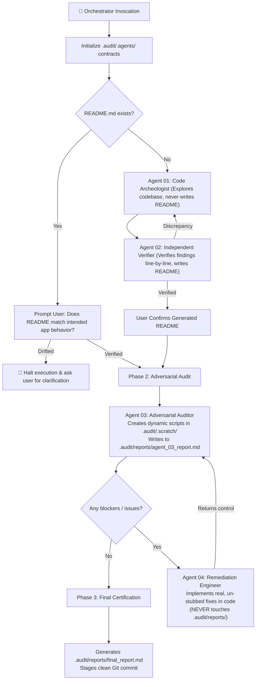

# 🚀 repo-publish-prep

[](https://github.com/antigravity-community/repo-publish-prep/actions)
[](LICENSE)

**`repo-publish-prep`** is an orchestrator-driven multi-agent verification protocol and developer toolkit designed to audit, sanitize, package, and standardize codebases before pushing or publishing to **GitHub, GitLab, Bitbucket**, or other remote Git hosting platforms.

The primary coordinator acts as the **Orchestrator**, actively spawning and managing dedicated subagents (`agent_01`, `agent_02`, `agent_03`, `agent_04`).

---

## 🛡️ Behavioral Isolation Contracts (`.audit/.agents/`)

To prevent subagents from overstepping their scope—such as **Agent 04 editing Agent 03's audit report** instead of fixing the application code—the Orchestrator enforces strict behavioral contracts stored in `.audit/.agents/`:
- **`agent_01.md`**: Permitted writes: `.audit/reports/agent_01_report.md` & `.audit/.scratch/`. Forbidden: `README.md`, application code.
- **`agent_02.md`**: Permitted writes: `README.md`. Forbidden: `.audit/reports/`, application code.
- **`agent_03.md`**: Permitted writes: `.audit/.scratch/` & `.audit/reports/agent_03_report.md`. Forbidden: ANY application code or `README.md`.
- **`agent_04.md`**: Permitted writes: Application code & configs. **CRITICAL RESTRICTION: MUST NEVER TOUCH `.audit/reports/` (INCLUDING `agent_03_report.md` AND `final_report.md`)!** All audit reports are strictly owned by Agent 03 and the Orchestrator.

The Orchestrator injects the exact behavioral contract from `.audit/.agents/agent_XX.md` into each subagent's system prompt and task instructions.

---

## 🏗️ The 3-Phase, 4-Agent Architecture



---

## 🛠️ Dynamic Scripting in `.audit/.scratch/`

Instead of relying on rigid, pre-packaged scripts, subagents generate on-demand, targeted audit scripts in `.audit/.scratch/`:
1. **Eagerness Bias & Stubbing:** AST inspection for empty function bodies (`pass`, `...`), `raise NotImplementedError`, `// TODO` comments, and silent error swallowers (`except Exception: pass`).
2. **Dependency Manifest Mismatches:** Compares all source code imports against manifest files (`requirements.txt`, `pyproject.toml`, `package.json`, `Cargo.toml`, `go.mod`).
3. **Local Environment & Path Leaks:** Flags hardcoded developer paths (`C:\Users\...`, `/home/...`) and internal private IPs.
4. **Documentation-to-Code Drift:** Verifies that internal Markdown links and CLI entrypoints claimed in `README.md` actually exist on disk.
5. **Secrets & Zero-Leak Gate:** Pattern detection for API keys, tokens, and tracked `.env` files.

The `.audit/` directory is excluded in `.gitignore` so temporary audit scripts never pollute the repository.

---

## 📂 Repository Structure

```text
├── plugin.json                                # Plugin manifest for Antigravity & Agent ecosystems
├── AGENTS.md                                  # Universal root instructions for AI agents
├── README.md                                  # Repository overview and documentation
├── LICENSE                                    # Apache-2.0 license
├── .gitignore                                 # Clean gitignore configuration
├── .editorconfig                              # Standardized editor config
├── .github/
│   ├── workflows/ci.yml                       # CI test & audit pipeline
│   └── dependabot.yml                         # Automated dependency alerts
│
├── skills/
│   └── repo-publish-prep/
│       ├── SKILL.md                           # Master multi-agent orchestrator runbook
│       │
│       ├── templates/                         # Production-grade templates
│       │   ├── agents/                        # Behavioral contracts (agent_01..04.md)
│       │   ├── audit/                         # agent_03_report & final_report templates
│       │   ├── gitignore/                     # Node, Python, Go, Rust, Universal
│       │   ├── docs/                          # README, CONTRIBUTING, SECURITY, EditorConfig
│       │   ├── github/                        # Workflows, Issue & PR templates, Dependabot
│       │   ├── gitlab/                        # .gitlab-ci.yml
│       │   └── bitbucket/                     # bitbucket-pipelines.yml
│       │
│       └── references/                        # Deep runbooks & guides
│           ├── readiness_checklist.md         # 50-point pre-flight checklist
│           ├── secrets_remediation.md         # Git history scrubbing (git-filter-repo)
│           ├── license_selection_guide.md     # SPDX license decision tree
│           └── platform_feature_matrix.md     # Multi-platform feature mapping
```

---

## 🌐 Universal Harness & Agent Agnosticism

This skill operates seamlessly across any agent harness:

| Harness / Agent | Configuration Method | Location |
| :--- | :--- | :--- |
| **Claude Code** | Native skill directory | `.claude/skills/repo-publish-prep/` or `skills/repo-publish-prep/` |
| **Cursor** | Context rules | Include reference in `.cursorrules` or `.cursor/skills/` |
| **Windsurf** | Project rule | Mention skill workflow in `.windsurfrules` |
| **GitHub Copilot** | Repository instructions | Reference in `.github/copilot-instructions.md` |
| **Antigravity / Gemini** | Plugin or workspace skill | Mount `plugin.json` or place in `.agents/skills/` |
| **Cline / Roo Code** | Custom instructions | Add `AGENTS.md` to system prompt / project memory |
| **Aider** | Command / instructions | Pass `skills/repo-publish-prep/SKILL.md` to `/read` or `.aider.conf.yml` |
| **Custom Agent / Swarms** | System prompt / Tool calling | Point LLM to `SKILL.md` and equip standard shell & file tools |

---

## 📄 License

Licensed under the [Apache License, Version 2.0](LICENSE).
