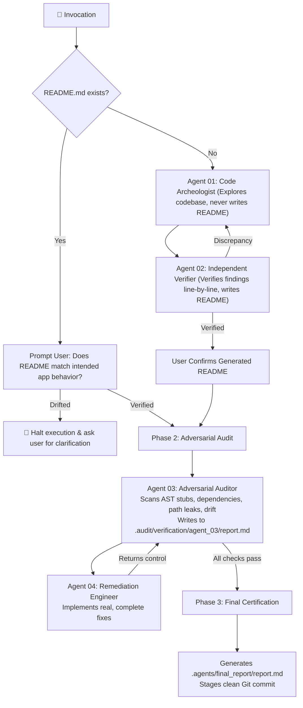

# 🚀 repo-publish-prep

[](https://github.com/antigravity-community/repo-publish-prep/actions)
[](LICENSE)
[](https://python.org)

**`repo-publish-prep`** is an adversarial multi-agent verification protocol and developer toolkit designed to audit, sanitize, package, and standardize codebases before pushing or publishing to **GitHub, GitLab, Bitbucket**, or other remote Git hosting platforms.

Unlike generic audits that only check for file existence, `repo-publish-prep` runs deep AST forensic inspections to eliminate **agent eagerness bias**, **unimplemented stubs**, **phantom/undeclared dependencies**, **hardcoded local environment leaks**, and **documentation-to-code drift**.

---

## 🏗️ The 3-Phase, 4-Agent Architecture



---

## 🔍 The 7 Specialized Irregularity Checks

1. **Eagerness Bias & Stubbing:** AST inspection for empty function bodies (`pass`, `...`), `raise NotImplementedError`, `// TODO` comments, and silent error swallowers (`except Exception: pass`).
2. **Dependency Manifest Mismatches:** Compares all source code imports (`import x`, `require('x')`) against manifest files (`requirements.txt`, `pyproject.toml`, `package.json`) to catch undeclared external packages before deployment crashes.
3. **Local Environment & Path Leaks:** Flags hardcoded developer paths (`C:\Users\...`, `/home/...`), internal private IPs, and hardcoded localhost ports.
4. **Documentation-to-Code Drift:** Verifies that internal Markdown links (`[guide](./docs/setup.md)`) and CLI entrypoints claimed in `README.md` actually exist on disk.
5. **Naming & Casing Hygiene:** Inconsistent naming conventions, typos, or misleading symbols.
6. **Import Errors & Grouping:** Syntax integrity, circular imports, and import ordering standards.
7. **Secrets & Zero-Leak Gate:** AST/regex pattern detection for Google/Gemini, OpenAI, Anthropic, AWS, GitHub PATs, JWTs, DB credentials, and tracked `.env` files.

---

## 📂 Repository Structure

```text
├── plugin.json                                # Plugin manifest for Antigravity & Agent ecosystems
├── AGENTS.md                                  # Universal root instructions for AI agents
├── README.md                                  # Repository overview and documentation
├── LICENSE                                    # Apache-2.0 license
├── .gitignore                                 # Clean gitignore configuration
├── .editorconfig                              # Standardized editor config
├── .github/
│   ├── workflows/ci.yml                       # CI test & audit pipeline
│   └── dependabot.yml                         # Automated dependency alerts
│
├── skills/
│   └── repo-publish-prep/
│       ├── SKILL.md                           # Master multi-agent protocol runbook
│       │
│       ├── scripts/                           # Specialized forensic Python 3 CLI utilities
│       │   ├── audit_repo.py                  # Master auditor & scorecard generator
│       │   ├── scan_stubs.py                  # AST stub & eagerness bias hunter
│       │   ├── scan_dependencies.py           # AST import vs manifest mismatch scanner
│       │   ├── scan_path_leaks.py             # Local path & environment leak detector
│       │   ├── scan_doc_drift.py              # Dead Markdown link & drift validator
│       │   └── generate_env_example.py        # Automated sanitized .env.example generator
│       │
│       ├── templates/                         # Battle-tested templates
│       │   ├── audit/                         # agent_03_report & final_report templates
│       │   ├── gitignore/                     # Node, Python, Go, Rust, Universal
│       │   ├── docs/                          # README, CONTRIBUTING, SECURITY, EditorConfig
│       │   ├── github/                        # Workflows, Issue & PR templates, Dependabot
│       │   ├── gitlab/                        # .gitlab-ci.yml
│       │   └── bitbucket/                     # bitbucket-pipelines.yml
│       │
│       └── references/                        # Deep runbooks & guides
│           ├── readiness_checklist.md         # 50-point pre-flight checklist
│           ├── secrets_remediation.md         # Git history scrubbing (git-filter-repo)
│           ├── license_selection_guide.md     # SPDX license decision tree
│           └── platform_feature_matrix.md     # Multi-platform feature mapping
│
└── tests/
    ├── test_audit_repo.py                     # Master auditor unit tests
    └── test_specialized_scanners.py           # Forensic AST scanners unit tests
```

---

## 💻 Standalone Forensic CLI Usage

All bundled scripts run on **Python 3.10+** using standard library with **zero external dependencies**.

```bash
# 1. Run complete audit & generate Agent 03 report
python skills/repo-publish-prep/scripts/audit_repo.py . --agent-report .audit/verification/agent_03/report.md

# 2. Run individual forensic scanners
python skills/repo-publish-prep/scripts/scan_stubs.py .
python skills/repo-publish-prep/scripts/scan_dependencies.py .
python skills/repo-publish-prep/scripts/scan_path_leaks.py .
python skills/repo-publish-prep/scripts/scan_doc_drift.py .

# 3. Generate sanitized .env.example
python skills/repo-publish-prep/scripts/generate_env_example.py .
```

---

## 🌐 Universal Harness & Agent Agnosticism

This skill operates seamlessly across any agent harness:

| Harness / Agent | Configuration Method | Location |
| :--- | :--- | :--- |
| **Claude Code** | Native skill directory | `.claude/skills/repo-publish-prep/` or `skills/repo-publish-prep/` |
| **Cursor** | Context rules | Include reference in `.cursorrules` or `.cursor/skills/` |
| **Windsurf** | Project rule | Mention skill workflow in `.windsurfrules` |
| **GitHub Copilot** | Repository instructions | Reference in `.github/copilot-instructions.md` |
| **Antigravity / Gemini** | Plugin or workspace skill | Mount `plugin.json` or place in `.agents/skills/` |
| **Cline / Roo Code** | Custom instructions | Add `AGENTS.md` to system prompt / project memory |
| **Aider** | Command / instructions | Pass `skills/repo-publish-prep/SKILL.md` to `/read` or `.aider.conf.yml` |
| **Custom Agent / Swarms** | System prompt / Tool calling | Point LLM to `SKILL.md` and equip standard shell & file tools |
| **Human Developer** | Standalone CLI | Run `python skills/repo-publish-prep/scripts/audit_repo.py .` |

---

## 🧪 Testing

Run the full unit test suite (10 test suites covering general audit, stubs, dependencies, path leaks, doc drift):

```bash
python -m unittest discover -s tests -p "test_*.py"
```

---

## 📄 License

Licensed under the [Apache License, Version 2.0](LICENSE).
