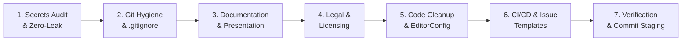

# 🚀 repo-publish-prep

[](https://github.com/antigravity-community/repo-publish-prep/actions)
[](LICENSE)
[](https://python.org)

**`repo-publish-prep`** is an autonomous Agent skill and developer toolkit designed to audit, sanitize, package, and standardize codebases before pushing or publishing to **GitHub, GitLab, Bitbucket**, or other remote Git hosting platforms.

---

## 🎯 Why This Skill Exists

When developers or AI coding agents build software, repositories often end up with:
- Accidental `.env` files or hardcoded API keys.
- Missing or generic `.gitignore` leaving bloated `node_modules/`, `__pycache__/`, or OS junk (`.DS_Store`).
- Absent or boilerplate `README.md` files without installation or configuration details.
- Missing `LICENSE` files (which legally makes code proprietary by default).
- Oversized binaries or dataset files (> 50MB) that trigger Git push rejections.
- No CI/CD workflows, issue templates, or security reporting mechanisms.

This skill automates the **entire pre-flight verification gate**, giving agents and teams a clean, publication-ready repository with one command.

---

## 🏛️ The 7-Pillar Readiness Framework



1. **Secret & Credential Sanitization:** Zero-dependency AST/regex secret scanner (Google, OpenAI, AWS, GitHub PATs, JWTs, DB credentials, private keys).
2. **Git Hygiene & .gitignore Completeness:** Validates `.gitignore` against detected tech stacks (Node, Python, Go, Rust, Docker) and audits git index tracking.
3. **Repository Documentation:** High-impact, modular `README.md`, `CONTRIBUTING.md`, and `SECURITY.md`.
4. **Licensing & Legal Compliance:** Guidance and verification for MIT, Apache-2.0, BSD-3-Clause, or Proprietary licenses.
5. **Code Quality & Cleanliness:** Purges scratch files, debug logs, and establishes universal `.editorconfig`.
6. **CI/CD & Automation:** Multi-platform CI workflows (GitHub Actions, GitLab CI, Bitbucket Pipelines), issue forms, and Dependabot.
7. **Pre-Flight Verification:** Automated readiness scoring (0–100) with diagnostic report output.

---

## 📂 Repository Structure

```text
├── plugin.json                                # Plugin manifest for Antigravity & Agent ecosystems
├── README.md                                  # Repository overview and documentation
├── LICENSE                                    # Apache-2.0 license
├── .gitignore                                 # Clean gitignore configuration
├── .editorconfig                              # Standardized editor config
├── .github/
│   ├── workflows/ci.yml                       # CI test & audit pipeline
│   └── dependabot.yml                         # Automated dependency alerts
│
├── skills/
│   └── repo-publish-prep/
│       ├── SKILL.md                           # Main agent runbook & instructions
│       │
│       ├── scripts/                           # Zero-dependency Python 3 CLI utilities
│       │   ├── audit_repo.py                  # Codebase readiness auditor & scorecard
│       │   └── generate_env_example.py        # Automated .env.example generator
│       │
│       ├── templates/                         # Battle-tested templates
│       │   ├── gitignore/                     # Node, Python, Go, Rust, Universal
│       │   ├── docs/                          # README, CONTRIBUTING, SECURITY, EditorConfig
│       │   ├── github/                        # Workflows, Issue & PR templates, Dependabot
│       │   ├── gitlab/                        # .gitlab-ci.yml
│       │   └── bitbucket/                     # bitbucket-pipelines.yml
│       │
│       └── references/                        # Deep runbooks & guides
│           ├── readiness_checklist.md         # 50-point pre-flight checklist
│           ├── secrets_remediation.md         # Git history scrubbing (git-filter-repo)
│           ├── license_selection_guide.md     # SPDX license decision tree
│           └── platform_feature_matrix.md     # Multi-platform feature mapping
│
└── tests/
    └── test_audit_repo.py                     # Unit test suite
```

---

## 💻 CLI Usage (Standalone)

The bundled scripts require **Python 3.10+** and have **zero external dependencies**.

### 1. Run the Codebase Auditor

```bash
# Scan current directory and print console report
python skills/repo-publish-prep/scripts/audit_repo.py .

# Output machine-readable JSON for automated tooling
python skills/repo-publish-prep/scripts/audit_repo.py . --json

# Generate a Markdown report artifact
python skills/repo-publish-prep/scripts/audit_repo.py . --markdown READINESS_REPORT.md

# Fail with non-zero exit code if blockers are detected (ideal for CI)
python skills/repo-publish-prep/scripts/audit_repo.py . --fail-on-blockers
```

### 2. Generate `.env.example`

Scans existing `.env` files and source code for environment variables, strips real values, and outputs safe placeholders:

```bash
python skills/repo-publish-prep/scripts/generate_env_example.py .
```

---

## 🌐 Universal Harness & Agent Agnosticism

This skill is designed from the ground up to be **100% harness- and agent-agnostic**. It requires only standard terminal access (`python 3.8+`, `git 2.x`) and file system read/write tools. There are zero proprietary SDKs, vendor token constraints, or harness-specific dependencies.

### Integration Matrix by Harness

| Harness / Agent | Configuration Method | Location |
| :--- | :--- | :--- |
| **Claude Code** | Native skill directory | `.claude/skills/repo-publish-prep/` or `skills/repo-publish-prep/` |
| **Cursor** | Context rules | Include reference in `.cursorrules` or `.cursor/skills/` |
| **Windsurf** | Project rule | Mention skill workflow in `.windsurfrules` |
| **GitHub Copilot** | Repository instructions | Reference in `.github/copilot-instructions.md` |
| **Antigravity / Gemini** | Plugin or workspace skill | Mount `plugin.json` or place in `.agents/skills/` |
| **Cline / Roo Code** | Custom instructions | Add `AGENTS.md` to system prompt / project memory |
| **Aider** | Command / instructions | Pass `skills/repo-publish-prep/SKILL.md` to `/read` or `.aider.conf.yml` |
| **Custom Agent / Swarms** | System prompt / Tool calling | Point LLM to `SKILL.md` and equip `bash`/`exec` and `file` tools |
| **Human Developer** | Standalone CLI | Run `python skills/repo-publish-prep/scripts/audit_repo.py .` |

---

## 🤖 Activating the Skill

Regardless of which agent harness you use, instruct your agent:

> *"Prepare this codebase for publishing on GitHub."*  
> or  
> *"Run a final review readiness audit before I push to remote."*

The agent will read [`SKILL.md`](skills/repo-publish-prep/SKILL.md) (or [`AGENTS.md`](AGENTS.md)), execute the auditor script, report any blockers/warnings, generate required boilerplate from the templates, and ensure a clean git working tree.

---

## 🧪 Testing

Run the unit test suite:

```bash
python -m unittest discover -s tests -p "test_*.py"
```

---

## 📄 License

Licensed under the [Apache License, Version 2.0](LICENSE).
