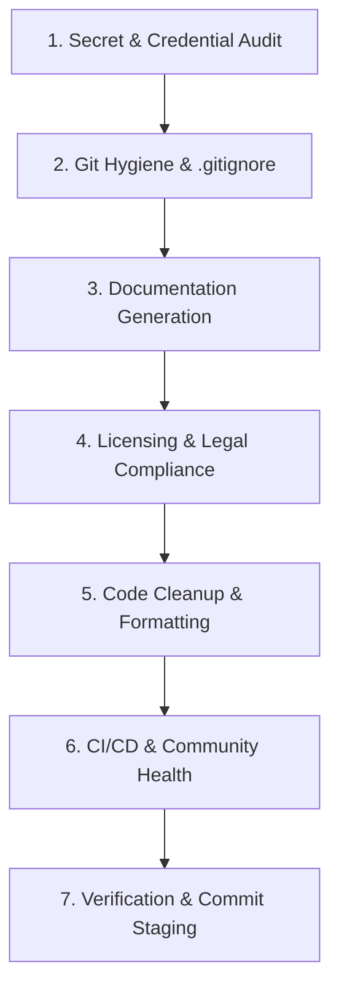

# Repository Publish & Hosting Preparation (`repo-publish-prep`)

Prepare, sanitize, audit, and package any codebase before publishing or pushing to GitHub, GitLab, Bitbucket, or another remote Git hosting platform.

This skill ensures zero leaked secrets, complete `.gitignore` protection, professional documentation, legal compliance, clean git history, and automated CI/CD workflows.

---

## 🌐 Harness & Agent Agnosticism

This skill is **100% harness- and agent-agnostic**. It operates identically across any autonomous coding assistant, multi-agent swarm, or human terminal.

- **Zero Proprietary Couplings:** Does not rely on vendor-specific APIs, proprietary SDKs, or closed agent runtimes.
- **Minimal System Requirements:**
  - Terminal/Shell tool: To execute standard `python 3.8+` and `git 2.x` commands.
  - File Read/Write tool: To inspect, create, or update repository files.
- **Compatible Harnesses & Environments:**
  - **Claude Code** (`.claude/skills/` or `skills/`)
  - **Cursor / Windsurf** (`.cursorrules`, `.windsurfrules`, or rule context)
  - **GitHub Copilot / Copilot Workspace** (`.github/copilot-instructions.md`)
  - **Gemini CLI / Antigravity** (`.agents/skills/` or plugin)
  - **Cline / Roo Code / Aider** (Project memory or instruction prompt)
  - **Custom LLM Agents / LangChain / AutoGen / CrewAI / ReAct** (Standard tool calling)
  - **Human Developers** (Standalone CLI via command line)

---

## Operating Modes

When activated, determine the user's intent:

1. **Audit / Diagnostic Mode (Default):**
   - Run the automated auditor and present a structured **Readiness Scorecard** with Blockers, Warnings, and Recommendations.
   - Do not modify files until the user reviews findings or requests remediation.

2. **Remediation / Interactive Mode:**
   - Walk through findings step-by-step, generating missing files and sanitizing issues with user confirmation.

3. **Full Preparation Mode:**
   - Execute an end-to-end sweep: audit, sanitize, scaffold missing documentation/templates, clean scratch files, verify build/tests, and prepare clean Git commits.

---

## The 7-Pillar Preparation Workflow



---

### Phase 1: Automated Readiness Audit

Run the bundled zero-dependency Python audit tool on the target codebase:

```bash
python <SKILL_DIR>/scripts/audit_repo.py <TARGET_DIRECTORY>
```

To generate a machine-readable JSON summary or a Markdown report artifact:

```bash
# JSON output
python <SKILL_DIR>/scripts/audit_repo.py <TARGET_DIRECTORY> --json

# Markdown report output
python <SKILL_DIR>/scripts/audit_repo.py <TARGET_DIRECTORY> --markdown <TARGET_DIRECTORY>/READINESS_REPORT.md
```

Review the scorecard output:
- 🛑 **BLOCKERS:** Must be resolved before publishing (e.g., exposed API keys, tracked `.env`, files > 50MB).
- ⚠️ **WARNINGS:** Highly recommended to resolve (e.g., missing LICENSE, missing README, uncommitted changes).
- 💡 **RECOMMENDATIONS:** Best practices (e.g., CI/CD workflow, issue templates, dependabot).

---

### Phase 2: Step-by-Step Remediation

#### Pillar 1: Secrets & Credentials Sanitization
1. **Never commit real secrets:**
   - If an API key or token was detected in code, move it to a local `.env` file or environment variable.
   - Check if sensitive files (`.env`, `*.pem`, `id_rsa`) are tracked in Git index with `git ls-files`.
   - If tracked, untrack immediately without deleting the local file:
     ```bash
     git rm --cached <file>
     ```
   - Refer to [Secrets Remediation Runbook](./references/secrets_remediation.md) if secrets were already committed to history.

2. **Generate `.env.example`:**
   - Run the bundled generator to detect all referenced environment variables and create a sanitized template:
     ```bash
     python <SKILL_DIR>/scripts/generate_env_example.py <TARGET_DIRECTORY>
     ```

#### Pillar 2: Git Hygiene & Complete `.gitignore`
1. Ensure `.gitignore` exists and includes universal ignore rules:
   - Copy or append from [Universal .gitignore](./templates/gitignore/gitignore-universal.txt).
2. Append stack-specific rules based on detected technologies:
   - Node / TS: [Node .gitignore](./templates/gitignore/gitignore-node.txt)
   - Python: [Python .gitignore](./templates/gitignore/gitignore-python.txt)
   - Go: [Go .gitignore](./templates/gitignore/gitignore-go.txt)
   - Rust: [Rust .gitignore](./templates/gitignore/gitignore-rust.txt)

#### Pillar 3: Documentation & Presentation
1. **`README.md`:**
   - If missing or generic, draft a comprehensive `README.md` using [README Template](./templates/docs/README.template.md).
   - Must include: Project title, concise overview, architecture/features, prerequisites, installation, configuration table, usage commands, testing instructions, and license link.
2. **`CONTRIBUTING.md`:**
   - Use [CONTRIBUTING Template](./templates/docs/CONTRIBUTING.template.md) to define PR requirements, code standards, and branch strategy.
3. **`SECURITY.md`:**
   - Use [SECURITY Template](./templates/docs/SECURITY.template.md) to establish a responsible vulnerability reporting channel.

#### Pillar 4: Licensing & Legal Compliance
1. Check if a `LICENSE` file exists.
2. If missing, consult the user or refer to [License Selection Guide](./references/license_selection_guide.md):
   - **MIT:** Permissive, lightweight, maximum adoption.
   - **Apache-2.0:** Permissive with explicit contributor patent grants.
   - **Proprietary:** Closed-source, All Rights Reserved.
3. Ensure copyright year and owner placeholders are replaced with actual values.

#### Pillar 5: Code Quality & Cleanliness
1. Remove temporary agent scratch directories, debug dumps, and OS junk (`.DS_Store`, `Thumbs.db`).
2. Add universal [`.editorconfig`](./templates/docs/editorconfig.template) to standardize indentation, line endings, and charset.
3. Run project formatters and linters (e.g., `npm run lint`, `ruff check`, `black`, `cargo fmt`).

#### Pillar 6: CI/CD & Community Health
1. Setup automated Continuous Integration workflow under `.github/workflows/ci.yml`:
   - Node: [Node CI Workflow](./templates/github/workflows/ci-node.yml)
   - Python: [Python CI Workflow](./templates/github/workflows/ci-python.yml)
   - Generic: [Generic CI Workflow](./templates/github/workflows/ci-generic.yml)
2. Setup automated security updates: [Dependabot Config](./templates/github/dependabot.yml).
3. Setup GitHub Community templates:
   - Issue Templates: [Bug Report](./templates/github/ISSUE_TEMPLATE/bug_report.yml), [Feature Request](./templates/github/ISSUE_TEMPLATE/feature_request.yml)
   - Pull Request: [PR Template](./templates/github/PULL_REQUEST_TEMPLATE.md)
4. (Optional) For GitLab or Bitbucket, provide:
   - GitLab: [GitLab CI Config](./templates/gitlab/gitlab-ci.yml)
   - Bitbucket: [Bitbucket Pipelines](./templates/bitbucket/bitbucket-pipelines.yml)

---

### Phase 3: Final Verification & Staging

1. **Rerun Auditor to verify 100% clean bill of health:**
   ```bash
   python <SKILL_DIR>/scripts/audit_repo.py <TARGET_DIRECTORY> --fail-on-blockers
   ```
2. **Verify build and test passes locally:**
   - Ensure the project builds without errors.
   - Run the test suite (`npm test`, `pytest`, `cargo test`, etc.).
3. **Check Git Status:**
   ```bash
   git status
   ```
   - Verify only desired files are staged.
   - Ensure no credentials, binaries, or unwanted files appear in untracked files.
4. **Present readiness summary to user** and offer to stage a clean initial or prep commit:
   ```bash
   git add .
   git commit -m "chore: prepare repository for GitHub publishing"
   ```

---

## References & Tools

- 🛠️ [Auditor Script](./scripts/audit_repo.py)
- 🛠️ [Env Example Generator](./scripts/generate_env_example.py)
- 📖 [Readiness Checklist](./references/readiness_checklist.md)
- 📖 [Secrets Remediation Runbook](./references/secrets_remediation.md)
- 📖 [License Selection Guide](./references/license_selection_guide.md)
- 📖 [Platform Feature Matrix](./references/platform_feature_matrix.md)
