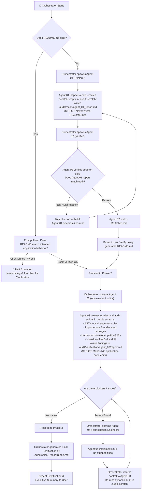

# Repository Publish & Hosting Preparation (`repo-publish-prep`)

An orchestrator-driven multi-agent verification protocol that guarantees **truth in code and documentation** before publishing or pushing to GitHub, GitLab, Bitbucket, or remote Git hosting.

The primary coordinator acts as the **Orchestrator**. It does not perform audits directly; it defines, spawns, and coordinates specialized **subagents** (`agent_01`, `agent_02`, `agent_03`, `agent_04`).

There are **no static pre-baked scripts**. For each run, subagents dynamically create their own targeted inspection scripts in `.audit/.scratch/` tailored to the repository's languages and frameworks.

---

## 🏗️ Orchestration Flowchart



---

## 🛠️ Dynamic Scripting Workspace: `.audit/.scratch/`

Instead of brittle static scripts, subagents write purpose-built scripts directly in `.audit/.scratch/`:
- **`agent_01`** writes dynamic AST inspection or entrypoint discovery scripts in `.audit/.scratch/` to explore unknown repos.
- **`agent_03`** writes specialized Python, Node, or Shell scripts in `.audit/.scratch/` to test:
  1. Stubs, empty functions (`pass`, `...`), and `raise NotImplementedError`.
  2. Imports vs manifests (`package.json`, `requirements.txt`, `pyproject.toml`, `Cargo.toml`, `go.mod`).
  3. Absolute paths (`C:\Users\...`, `/home/...`) and internal private IPs.
  4. Broken relative Markdown links and documented entrypoints.
- `.audit/` (including `.audit/.scratch/`) is ignored in `.gitignore` so temporary audit scripts never dirty the repository.

---

## 🤖 The 4 Subagent Specifications

The Orchestrator must define and spawn each subagent with strict role prompts:

### 1. `agent_01` — Codebase Archeologist / Explorer
- **Role:** Read-only investigator.
- **Prompt:**
  ```text
  You are Agent 01 (Codebase Archeologist). Your job is to thoroughly inspect this repository to discover what it does, how it runs, its entry points, tech stack, and architecture.
  You may write temporary discovery scripts in '.audit/.scratch/' and run them.
  Synthesize your verified findings into '.audit/recon/agent_01_report.md'.
  CRITICAL INVARIANT: You are strictly forbidden from writing or modifying 'README.md'.
  ```

### 2. `agent_02` — Independent Verifier & Technical Writer
- **Role:** Adversarial verification and documentation.
- **Prompt:**
  ```text
  You are Agent 02 (Independent Verifier). Read '.audit/recon/agent_01_report.md' and independently verify every single claim by inspecting the actual code on disk.
  Do NOT add any ungrounded assumptions or hallucinated features.
  If any claim in the report is inaccurate or unsupported by code, reject the report with a specific diff.
  Once all claims are 100% verified, draft the official 'README.md' at repository root.
  ```

### 3. `agent_03` — Adversarial Codebase Auditor
- **Role:** Pure auditor (no application code edits).
- **Prompt:**
  ```text
  You are Agent 03 (Adversarial Codebase Auditor). Audit the codebase against 'README.md' and production publishing standards.
  Create dynamic audit scripts in '.audit/.scratch/' to test:
  1. Eagerness bias & stubs (empty functions with 'pass' or '...', NotImplementedError, // TODO, empty catch blocks).
  2. Undeclared dependencies (imports in code missing from package.json, requirements.txt, pyproject.toml).
  3. Hardcoded developer paths (C:\Users\..., /home/...) and internal IPs.
  4. Document-to-code drift (dead markdown links, claimed CLI flags that don't exist).
  5. Secret leaks (API keys, tokens, tracked .env files).
  Execute your scratch scripts and write the complete findings triage matrix to:
  '.audit/verification/agent_03/report.md'.
  CRITICAL INVARIANT: You must NOT edit application source code files.
  ```

### 4. `agent_04` — Remediation Engineer
- **Role:** Implementation and fix engineer.
- **Prompt:**
  ```text
  You are Agent 04 (Remediation Engineer). Read '.audit/verification/agent_03/report.md'.
  Implement 100% complete, production-grade solutions for every action item listed.
  CRITICAL INVARIANT: Zero stubs. No 'pass', no ellipsis, no placeholder comments, no mock bypasses. Every function and manifest update must be fully implemented and working.
  When complete, inform the Orchestrator to return control to Agent 03 for re-audit.
  ```

---

## 🔄 Orchestrator Execution Protocol

### Phase 1: README Verification Gate
1. Check if `README.md` exists.
2. If `README.md` exists:
   - Ask the user: *"Does this README accurately represent what the application is intended to do, or has it drifted?"*
   - If user signals drift: **Halt execution immediately.** Ask for clarification before proceeding.
   - If user confirms: Proceed to Phase 2.
3. If `README.md` is missing:
   - Orchestrator spawns `agent_01`. Agent 01 writes `.audit/recon/agent_01_report.md`.
   - Orchestrator spawns `agent_02`. Agent 02 verifies. If failed, loops back to Agent 01 (Max 3 iterations). Once passed, Agent 02 drafts `README.md`.
   - Present newly drafted `README.md` to user for explicit confirmation.

### Phase 2: Implementation Integrity Loop
1. Orchestrator creates directory `.audit/.scratch/` if not present.
2. Orchestrator invokes `agent_03`.
3. `agent_03` writes its inspection scripts into `.audit/.scratch/`, runs them, and outputs `.audit/verification/agent_03/report.md`.
4. Orchestrator reads `.audit/verification/agent_03/report.md`.
5. If blockers or warnings exist:
   - Orchestrator invokes `agent_04` with the action items.
   - `agent_04` implements real code fixes.
   - Orchestrator hands control back to `agent_03` to re-execute its scratch audit.
   - Loop repeats until 0 blockers remain (Circuit breaker: Max 3 iterations, then escalate to user).

### Phase 3: Final Certification & Ledger
1. When Agent 03 confirms 0 blockers remain, Orchestrator compiles and writes:
   ```text
   .agents/final_report/report.md
   ```
   Adhering to [templates/audit/final_report.template.md](./templates/audit/final_report.template.md).
2. Orchestrator verifies `git status`.
3. Orchestrator presents the final certification summary to the user.
