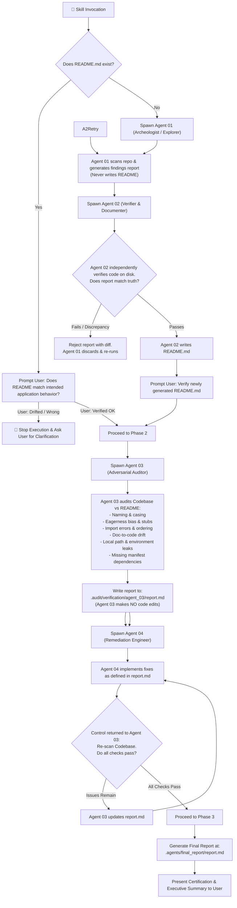

# Repository Publish & Hosting Preparation (`repo-publish-prep`)

An adversarial multi-agent verification protocol that guarantees **truth in code and documentation** before publishing or pushing to GitHub, GitLab, Bitbucket, or any remote Git hosting platform.

Unlike generic audits that only check for file existence, this skill executes deep AST forensic inspections to eliminate **agent eagerness bias**, **unimplemented stubs**, **phantom/undeclared dependencies**, **hardcoded local environment leaks**, **broken markdown links**, and **secret leaks**.

---

## 🏗️ The 3-Phase, 4-Agent Architecture



---

## 🌐 Harness Agnosticism

This protocol operates uniformly across any agent harness:
- **Multi-Agent Runtimes (Antigravity, Claude Code, Swarms):** Launches distinct, specialized subagents for Agent 01, 02, 03, and 04 with strict role boundaries.
- **Single-Agent Runtimes (Cursor, Windsurf, Copilot, Aider, CLI):** The primary agent sequentially adopts each of the 4 strict roles, observing tool boundaries and file write isolation between steps.

---

## Detailed Execution Protocol

### Phase 1: README Verification & Ground-Truth Reconstruction

The `README.md` is the legal contract between documentation and implementation.

#### Case A: `README.md` Exists
1. Read the existing `README.md`.
2. Present a concise summary to the user:
   > *"Here is the current documented purpose and behavior of the application. Does this accurately represent how the application is intended to run, or has it drifted?"*
3. **If user signals drift or disagreement:**
   - **Immediately halt execution.**
   - Do NOT edit codebase files.
   - Ask the user to clarify the intended application architecture and behavior before proceeding.
4. **If user confirms accuracy:**
   - Proceed directly to **Phase 2**.

#### Case B: `README.md` is Missing (Agent 01 ⇄ Agent 02 Loop)
When no README exists, launch two coordinated subagents:

1. **Launch Agent 01 (`agent_01` — Codebase Archeologist):**
   - **Role:** Read-only codebase explorer.
   - **Task:** Walk the repository tree, discover entrypoints, inspect functions, routes, CLI arguments, and configuration files.
   - **Output:** Writes an objective evidence report to `.audit/recon/agent_01_report.md`.
   - **STRICT INVARIANT:** *Agent 01 is strictly forbidden from writing `README.md` directly.*

2. **Launch Agent 02 (`agent_02` — Independent Verifier & Technical Writer):**
   - **Role:** Independent verifier and technical documenter.
   - **Task:** Reads `.audit/recon/agent_01_report.md` and independently cross-references every assertion against source code on disk.
   - **STRICT INVARIANT:** *Agent 02 must NOT add any new ungrounded information outside verified code facts.*
   - **Verification Gate:**
     - If Agent 02 detects any discrepancy, hallucination, or ungrounded claim: it notifies Agent 01 with a specific rejection diff. Agent 01 discards the draft, re-investigates, and submits a revised report. *(Loop terminates after max 3 iterations if unresolved, escalating to user).*
     - If verification passes: Agent 02 drafts `README.md` adhering to [templates/docs/README.template.md](./templates/docs/README.template.md).

3. **User Verification Gate:**
   - Present the newly generated `README.md` to the user for explicit review and confirmation.

---

### Phase 2: Implementation Integrity Loop (Agent 03 ⇄ Agent 04)

Once the README is confirmed as ground truth, audit the code for 7 critical classes of irregularities.

#### Step 2.1: Launch Agent 03 (`agent_03` — Adversarial Codebase Auditor)
- **Role:** Pure auditor (Read-only on source code).
- **Tooling:** Runs the bundled forensic AST scanners:
  ```bash
  python skills/repo-publish-prep/scripts/audit_repo.py <TARGET_DIRECTORY> --agent-report <TARGET_DIRECTORY>/.audit/verification/agent_03/report.md
  ```
- **Audits 7 Specialized Irregularity Classes:**
  1. **Eagerness Bias & Stubs:** Detects hollow implementations, `pass` function bodies, `raise NotImplementedError`, `// TODO` comments, and empty exception swallowers (`except Exception: pass`).
  2. **Dependency Manifest Mismatch:** Uses AST parsing (`scan_dependencies.py`) to catch modules imported in code but missing from `requirements.txt`, `pyproject.toml`, or `package.json`.
  3. **Local Environment & Path Leaks:** Detects hardcoded developer user paths (`C:\Users\...`, `/home/...`), internal IP addresses, and hardcoded localhost ports.
  4. **Document-to-Code Drift:** Detects broken Markdown relative links and verified CLI entrypoints claimed in README.
  5. **Naming & Casing Irregularities:** Inconsistent naming conventions, typos, or misleading symbols.
  6. **Import Errors & Ordering:** Syntax errors, broken relative imports, and import groupings.
  7. **Secrets & Credentials:** API keys, tokens, `.env` files tracked in Git.
- **Output:** Generates a structured triage report at:
  ```text
  .audit/verification/agent_03/report.md
  ```
- **STRICT INVARIANT:** *Agent 03 never edits source code files.*

#### Step 2.2: Launch Agent 04 (`agent_04` — Remediation Engineer)
- **Role:** Implementation and fix engineer.
- **Task:** Reads `.audit/verification/agent_03/report.md` and implements 100% complete, production-grade solutions:
  - Replaces hollow functions with full logic.
  - Adds missing packages to `requirements.txt` / `package.json`.
  - Replaces hardcoded user paths with environment variables or `pathlib` relative paths.
  - Fixes dead documentation links.
  - Removes sensitive credentials and generates `.env.example`.
- **STRICT INVARIANT:** *Agent 04 must write real, testable code. No stubs, no ellipsis, no mock bypasses.*

#### Step 2.3: Closed-Loop Re-Verification
- Agent 04 finishes edits and hands control back to **Agent 03**.
- Agent 03 re-executes the forensic scan:
  ```bash
  python skills/repo-publish-prep/scripts/audit_repo.py <TARGET_DIRECTORY> --agent-report <TARGET_DIRECTORY>/.audit/verification/agent_03/report.md
  ```
- If blockers remain: Agent 03 updates `report.md`, and Agent 04 iterates.
- **Circuit Breaker:** Maximum 3 iterations. If an issue cannot be resolved automatically after 3 loops, pause and request user guidance.
- When 0 blockers remain: Agent 03 certifies the loop as complete!

---

### Phase 3: Final Certification & Ledger

Once Phase 2 passes with 100% clean bill of health:

1. **Compile Final Report:**
   Write the comprehensive certification report to:
   ```text
   .agents/final_report/report.md
   ```
   Adhering to [templates/audit/final_report.template.md](./templates/audit/final_report.template.md).

2. **Present Final Certification to User:**
   - Display executive summary: Score (100/100), Zero Drift, Zero Stubs, Zero Undeclared Dependencies.
   - Confirm Git working tree cleanliness (`git status`).
   - Offer to stage a clean initial or pre-publish commit:
     ```bash
     git add .
     git commit -m "chore: complete adversarial pre-publish audit and certification"
     ```

---

## 🛠️ Bundled Diagnostic Tools

All helper tools use Python 3 standard library with **zero external dependencies**:

| Tool | Purpose | Direct CLI Usage |
| :--- | :--- | :--- |
| **`audit_repo.py`** | Master auditor & scorecard generator | `python scripts/audit_repo.py . --agent-report .audit/verification/agent_03/report.md` |
| **`scan_stubs.py`** | AST stub, `pass`, and eagerness bias hunter | `python scripts/scan_stubs.py .` |
| **`scan_dependencies.py`** | AST import vs manifest mismatch scanner | `python scripts/scan_dependencies.py .` |
| **`scan_path_leaks.py`** | Hardcoded Windows/POSIX user path scanner | `python scripts/scan_path_leaks.py .` |
| **`scan_doc_drift.py`** | Dead markdown link and drift scanner | `python scripts/scan_doc_drift.py .` |
| **`generate_env_example.py`** | Automated sanitized `.env.example` generator | `python scripts/generate_env_example.py .` |
